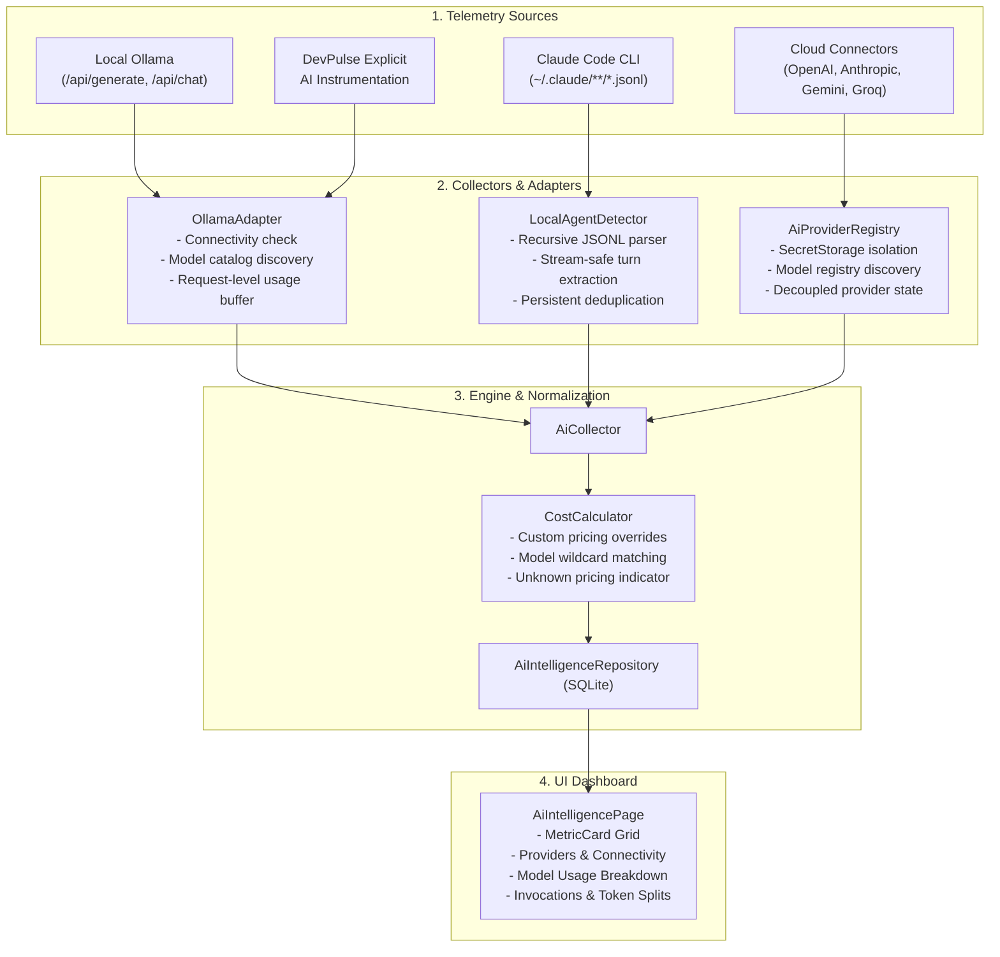
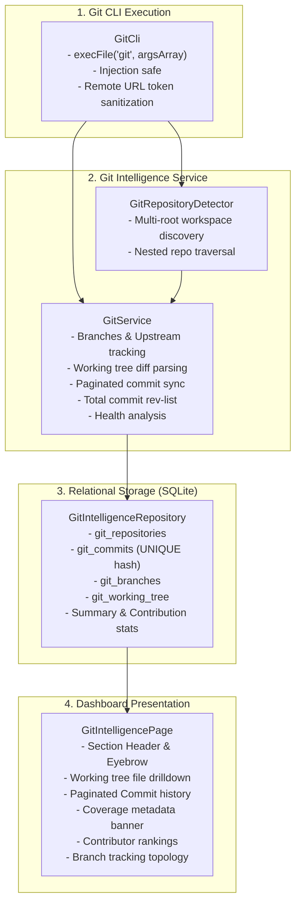

# DevPulse Phase 3 Completion & Deep Stabilization Specification

**Document Version:** 1.0.0  
**Phase:** Phase 3 Completion & Stabilization (AI Intelligence & Git Intelligence)  
**Author:** Antigravity Architect (Elephant Lead)  
**Date:** November 2026  
**Status:** DRAFT FOR GOLDFISH REVIEW  

---

## 1. Executive Summary & Problem Statement

DevPulse is a local-first developer observability extension for Visual Studio Code. Phases 1 and 2 established core telemetry (CPU, RAM, Disks, Processes, Listening Ports, File Tree Scanning, Duplicate File Hashing, Extension Drilldown, Process Termination, and Port Freeing).

Phase 3 introduced AI Intelligence and Git Intelligence. However, initial audits and user feedback revealed key stabilization requirements:
1. **AI Usage Attribution vs. Model Discovery:**
   - Cloud provider adapters (OpenAI, Anthropic, Gemini, Groq) check API connectivity and discover model catalogs via `/v1/models`. They do NOT query historical account invoices (which cloud providers do not expose programmatically).
   - Local Ollama reachability (`/api/version`) and model tags (`/api/tags`) were previously conflated with usage collection.
   - The system must cleanly decouple **Service Connectivity** from **Usage Tracking**, capture per-request token telemetry via instrumented paths and local agent logs (Claude Code, etc.), and never generate synthetic records.
2. **AI Pricing & Cost Calculation:**
   - Handle custom overrides, effective pricing snapshots, and unknown pricing states (which must never be presented as $0.00 unless explicitly on local hardware).
3. **Claude Code Session Telemetry:**
   - Parse recursive `.claude` directory structures (including projects/sessions) and streaming `.jsonl` files without duplicating usage across DevPulse restarts.
4. **Git Commit History Synchronization & Coverage:**
   - Replace arbitrary retrieval caps with paginated and incremental history synchronization, communicating exact historical coverage dates and repository commit totals.
5. **Git Branch & Contributor Accuracy:**
   - Branches without upstream tracking must never display misleading "Synchronized" or "0 ahead / 0 behind" states.
   - Contributor stats must reflect local Git commits without naive identity merging.
6. **UI/UX Polish & Consistency:**
   - Standardize headers, eyebrows, action clusters, cards, and data tables across both AI Intelligence and Git Intelligence dashboards in compliance with the DevPulse design system.

---

## 2. Architecture & Subsystem Specification

### 2.1 AI Intelligence Architecture



#### Provider Status Model
Every AI provider is evaluated across three decoupled dimensions:
1. `connectionStatus`: `'connected' | 'disconnected' | 'auth_failed' | 'provider_unavailable' | 'unsupported' | 'collection_error'`
2. `usageTrackingStatus`: `'usage_tracking_active' | 'usage_tracking_inactive'`
   - Local Ollama: Active when instrumented calls are recorded or routed through DevPulse.
   - Claude Code: Active when local CLI turn files are detected and ingested.
   - Cloud APIs without local proxy: Inactive with clear notice: `"API Active · Model Catalog Available · Usage tracking inactive"`.
3. `modelCatalogStatus`: `'model_catalog_available' | 'model_catalog_unavailable'`

#### Claude Code Ingestion Protocol
- Scans `~/.claude/` recursively up to depth 3 to discover monorepo and multi-project sessions.
- Ingests both `.json` and `.jsonl` files.
- Deduplication: uses idempotency key `${source}:${fileName}:${lineIndex}:${timestamp}:${promptTokens}:${completionTokens}`.
- Cross-session restart recovery: verified against SQLite index via `hasRecordWithSourceAndTimestamp(source, timestamp)`.

---

### 2.2 Git Intelligence Architecture



#### Git Commit Pagination & Coverage
- Computes `totalInRepo` via `git rev-list --count HEAD`.
- Tracks `oldestCommitDate` and `newestCommitDate` across synced batches.
- Provides `historyCoverage` contract in `GitIntelligenceData`:
  ```ts
  export interface GitHistoryCoverage {
    totalInRepo: number;
    syncedCommits: number;
    oldestCommitDate?: number;
    newestCommitDate?: number;
    hasMore: boolean;
  }
  ```
- Handles branches without upstream tracking: `aheadCount` and `behindCount` are set to `undefined` (rendered as `— (No tracking)`) instead of fabricated zeros.

---

### 2.3 UI/UX Design System Compliance

All dashboards strictly adhere to DevPulse visual guidelines:
- **Section Headers:**
  - Container: `<section className="section-header-row">`
  - Tag: `<div className="eyebrow-tag"><Icon size={13} /><span>CATEGORY</span></div>`
  - Title: `<h2 className="section-title">`
  - Description: `<p className="section-desc">`
  - Action Cluster: `<div className="header-action-group">`
- **Metric Cards:**
  - `<MetricCard label="..." value="..." detail="..." icon={...} variant="accent|info|warning|default" />`
  - Arranged inside `<section className="metric-cards-grid metrics-grid">`.
- **Search & Filters:**
  - `<div className="search-input-wrap"><Search size={14} /><input type="text" className="search-field" ... /></div>`
- **Tables & Panels:**
  - Wrapped inside `<article className="card panel-card">` with responsive scroll wrapper `<div className="table-responsive">`.

---

### 2.4 Strict Phase Boundary

| Subsystem | Phase 3 Scope | Phase 4 Scope (STRICTLY FORBIDDEN) |
|---|---|---|
| **AI Intelligence** | Local Ollama, Claude Code CLI logs, Cloud API model catalog connectors, pricing rules, daily budgets, token telemetry. | Generic HTTP proxy, outbound prompt interceptors. |
| **Git Intelligence** | Local branch topology, working tree status, commit history pagination, contributor statistics, health insights. | Cloud hosting PR creation, automated merging, remote code reviews. |
| **Coding Activity** | None. | Active keystroke tracking, idle time detection, language breakdown, editor sessions. |
| **API Intelligence** | None. | API ingestion server, Express middleware, endpoint latency tracking, HTTP request loggers. |

---

## 3. Database Schema Verification & Backward Compatibility

- **Engine:** SQL.js (WebAssembly SQLite) persisted locally in `globalStorageUri/devpulse.sqlite`.
- **Phase 1 Tables Preserved:** `metric_events`, `system_metrics`, `ai_usage`, `alerts`, `budgets`, `settings`, `coding_sessions`, `api_requests`.
- **Phase 2 Tables Preserved:** `file_scans`, `file_entries`, `folder_stats`, `duplicate_groups`, `disk_metrics`, `process_metrics`, `port_metrics`.
- **Phase 3 Tables:**
  - `ai_providers`: `id, name, status, endpoint, is_local, models_json, last_synced_at, created_at`
  - `ai_models`: `id, provider_id, name, display_name, context_window, is_local, last_used_at`
  - `ai_usage_records`: `id, workspace_id, provider, model, input_tokens, output_tokens, total_tokens, request_count, duration_ms, estimated_cost, currency, source, request_type, pricing_snapshot_json, timestamp`
  - `ai_pricing`: `id, provider, model_pattern, input_cost_per_million, output_cost_per_million, is_custom, updated_at`
  - `ai_budgets`: `id, period_type, limit_amount, threshold_percent, provider, model, created_at`
  - `git_repositories`: `id, workspace_path, name, root_path, current_branch, head_commit_hash, remotes_json, is_clean, last_polled_at`
  - `git_commits`: `id, repo_id, commit_hash, short_hash, author_name, author_email, message, timestamp, branch, files_changed, insertions, deletions` (UNIQUE on `repo_id, commit_hash`)
  - `git_branches`: `id, repo_id, name, is_current, is_remote, upstream, ahead_count, behind_count, last_commit_hash, last_commit_at`
  - `git_working_tree`: `id, repo_id, file_path, status, is_staged, old_path, timestamp`

---

## 4. Testing & Verification Matrix

1. **Automated Unit Tests:**
   - Provider status decoupling and model catalog availability.
   - Ollama request instrumentation (duration, tokens, zero cost).
   - Claude Code session ingestion, `.jsonl` parsing, and restart deduplication.
   - Custom pricing overrides and unknown pricing states.
   - Budget threshold alerts (50%, 85%, 100%).
   - Git branch missing upstream (`aheadCount: undefined`).
   - Git commit coverage calculation and pagination.
   - Working tree file status and rename handling.
2. **Regression Testing:**
   - Full execution of all 11 Vitest test suites (70 tests).
   - Zero ESLint errors or warnings.
   - Zero TypeScript compilation errors (`tsc --noEmit`).
3. **Packaging & Delivery:**
   - Full webview build via Vite.
   - Full extension bundling via esbuild.
   - Validated VSIX package `devpulse-0.3.0.vsix`.
